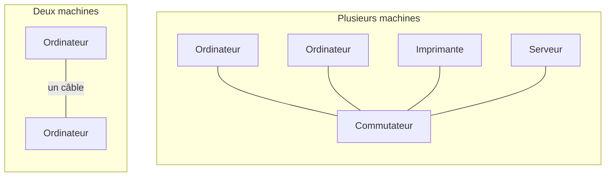
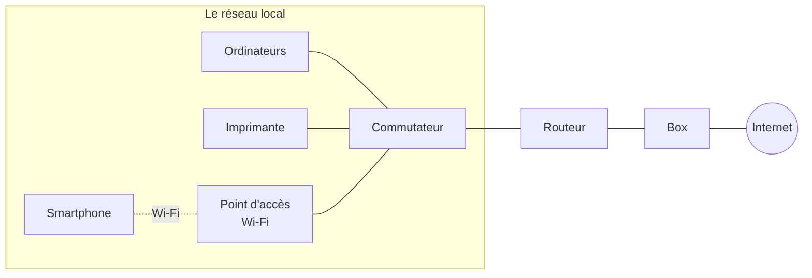
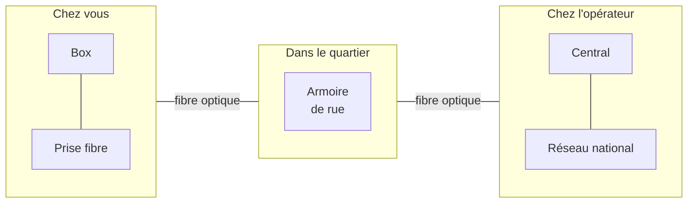
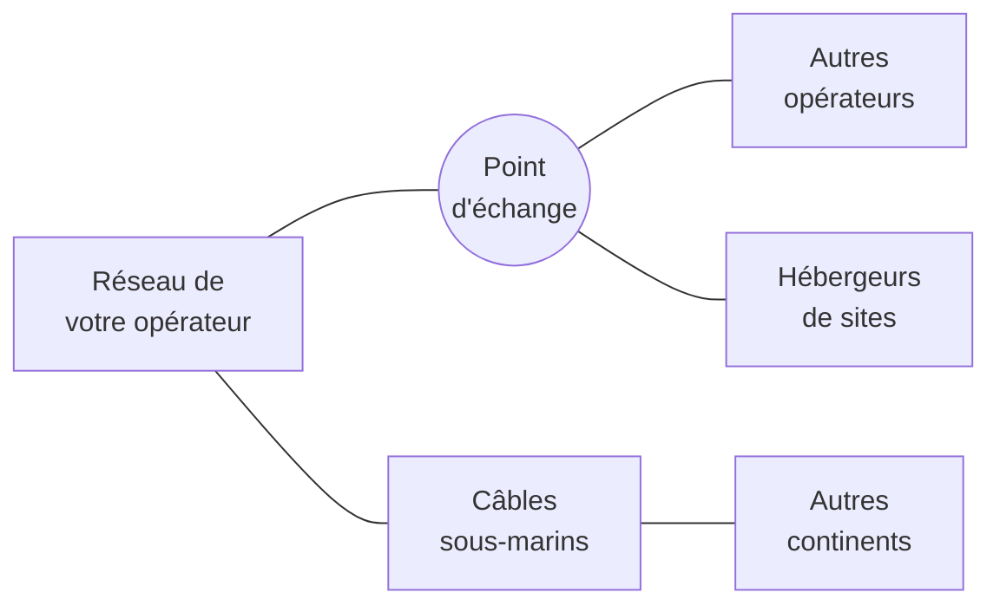
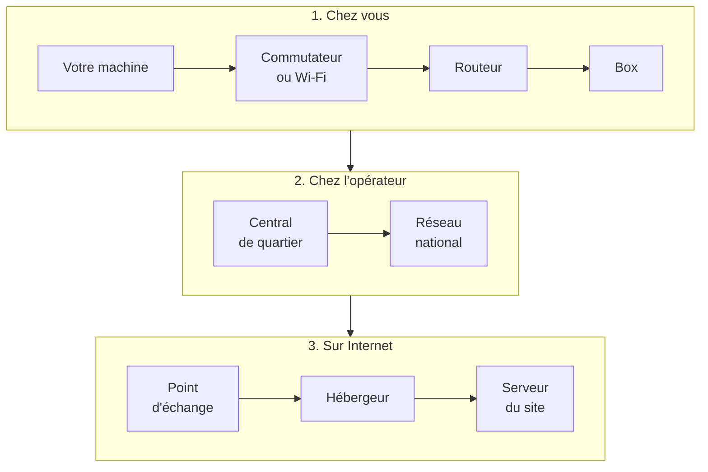

[Sommaire](Readme.md) · [Chapitre suivant →](02-Internet-reseau-de-reseaux.md)

# Qu'est-ce qu'un réseau ?

Un réseau informatique relie des machines pour qu'elles puissent **échanger des
informations**.

On peut le comparer au réseau routier. Les machines sont les maisons, les câbles
et les ondes radio sont les routes, les équipements réseau sont les carrefours
et les panneaux. Les règles communes, appelées **protocoles**, jouent le rôle du
code de la route : tout le monde doit les respecter pour que les échanges
aboutissent.

---

## 1. Le plus petit des réseaux

Deux ordinateurs reliés par un câble forment déjà un réseau. Dès qu'il y a plus
de deux machines, on les relie toutes à un boîtier central : le
**commutateur** (*switch* en anglais).

---

## 2. Le réseau local

Les machines d'un même lieu (une maison, une agence, un étage) forment un
**réseau local**. Elles communiquent directement entre elles : pour imprimer ou
ouvrir un dossier partagé, les données ne sortent pas du réseau local.

Le rôle de chaque équipement :

- le **commutateur** relie les machines du réseau local. Il sait sur quelle prise
  se trouve chaque machine et lui transmet ce qui lui est destiné ;
- le **point d'accès Wi-Fi** fait le même travail pour les appareils sans fil ;
- le **routeur** est la **porte de sortie** du réseau local : tout ce qui part
  vers un autre réseau passe par lui ;
- la **box** raccorde le réseau local à celui de l'opérateur.

> À la maison, la box assure tous ces rôles : commutateur, point d'accès Wi-Fi
> et routeur. En entreprise, chaque rôle est confié à un équipement distinct,
> plus robuste, géré par l'équipe informatique.

---

## 3. De la box à l'opérateur

La box est reliée à l'**opérateur** (Orange, SFR, Free, Bouygues Telecom...)
par une fibre optique. Cette fibre passe sous la rue jusqu'à une armoire de
quartier, puis jusqu'à un **central** de l'opérateur. Depuis ce central, le
réseau de l'opérateur couvre tout le pays.

À défaut de fibre, la box peut passer par la ligne téléphonique en cuivre
(ADSL), en cours d'abandon, ou par le réseau mobile 4G ou 5G.

L'opérateur attribue à la box une **adresse publique**. C'est sous cette adresse
que toute la maison apparaît sur Internet (chapitre 3).

---

## 4. De l'opérateur à Internet

Le réseau de l'opérateur est relié aux autres réseaux du monde de deux façons :
dans des **points d'échange**, des bâtiments où les réseaux se branchent les uns
aux autres, et par des **câbles sous-marins** qui rejoignent les autres
continents.

Le chapitre 2 détaille cette organisation.

---

## 5. Le chemin complet

En assemblant ces étapes, on obtient le chemin d'une information entre votre
machine et le serveur d'un site Web :

L'information passe d'un équipement à l'autre, comme un colis qui transite par
plusieurs centres de tri. Chaque équipement sait seulement à qui la transmettre
ensuite. Le chapitre 7 montre comment observer ce trajet depuis votre machine.

---

## L'essentiel

- Un réseau relie des machines qui suivent des règles communes, les protocoles.
- Le commutateur relie les machines d'un réseau local, le routeur est la porte
  de sortie, la box raccorde à l'opérateur. À la maison, la box regroupe ces
  rôles.
- Depuis la box, le chemin passe par l'opérateur, puis par les points d'échange
  et les câbles sous-marins, jusqu'au serveur.

---

## Exercices

### Exercice 1 - Un câble débranché

Dans une agence, quelqu'un débranche le câble entre le routeur et la box.
Qu'est-ce qui fonctionne encore ?

Voir la correction

Les échanges à l'intérieur du **réseau local** continuent : les postes peuvent
imprimer, ouvrir les dossiers partagés et communiquer entre eux. En revanche,
plus rien ne peut sortir vers Internet, puisque le lien entre le routeur et
l'opérateur est coupé.

### Exercice 2 - Les rôles de la box

Quels rôles joue la box, à la maison ?

Voir la correction

Elle se raccorde à l'opérateur. Elle sert aussi de **commutateur** (ses prises
Ethernet), de **point d'accès Wi-Fi** et de **routeur**.

---

[Sommaire](Readme.md) · [Chapitre suivant →](02-Internet-reseau-de-reseaux.md)
