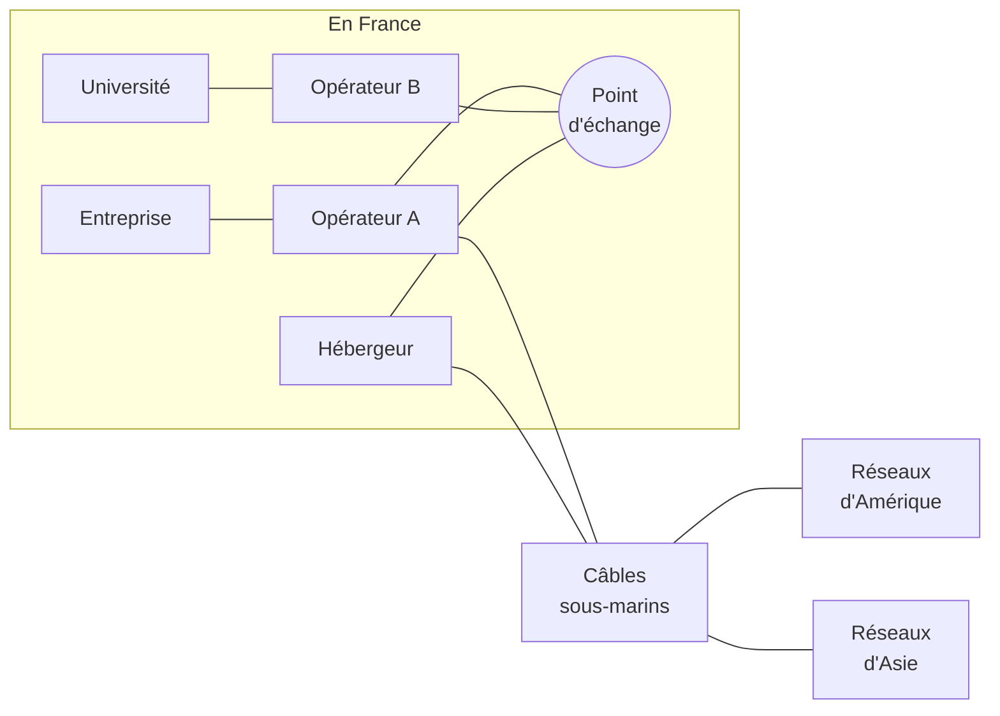
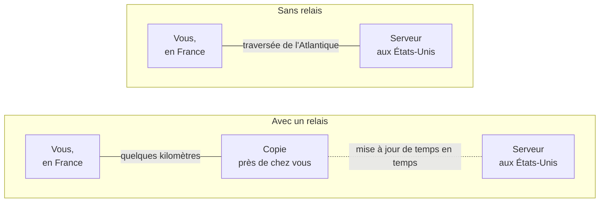
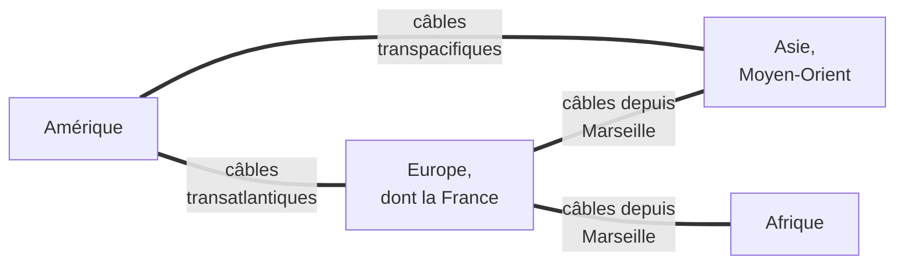
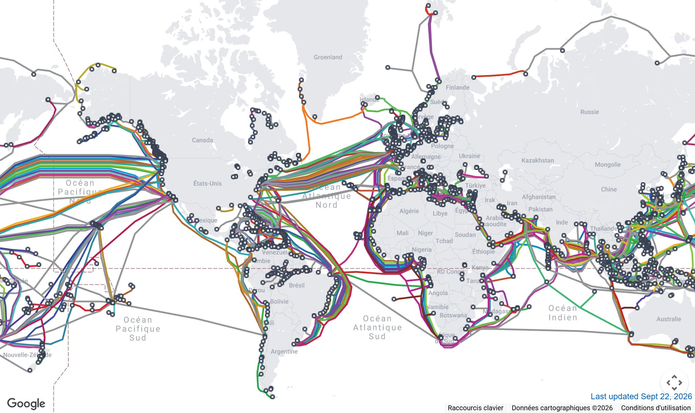
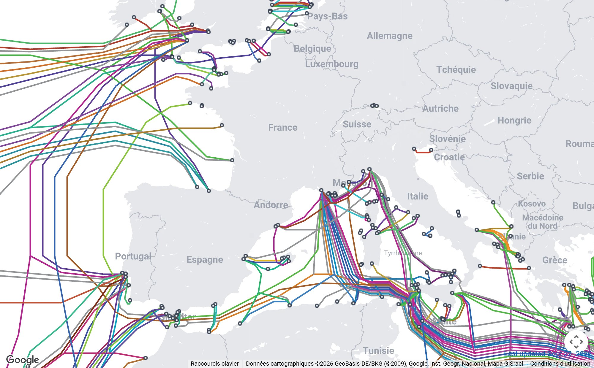

[← Chapitre précédent](01-Qu-est-ce-qu-un-reseau.md) · [Sommaire](Readme.md) · [Chapitre suivant →](03-Adresse-IP.md)

# Internet, un réseau de réseaux

Aucune organisation ne possède Internet. Il est formé de **dizaines de milliers
de réseaux indépendants** (opérateurs, hébergeurs, entreprises, universités) qui
se sont reliés entre eux et utilisent tous le même protocole, **IP**.

La comparaison avec le réseau routier européen fonctionne bien : chaque pays
construit et entretient ses routes, elles se raccordent aux frontières, et l'on
peut aller de Lisbonne à Helsinki sans changer de voiture.

> Internet et le Web sont deux choses différentes. Le Web désigne les sites
> consultés dans un navigateur. C'est un des services qui utilisent Internet,
> au même titre que la messagerie, la visioconférence, les jeux en ligne ou les
> mises à jour.

---

## 1. Là où les réseaux se rejoignent

Les réseaux se branchent les uns aux autres dans des **points d'échange** : des
salles situées dans des bâtiments sécurisés, où chaque réseau installe ses
équipements et se relie aux autres. En France, les principaux se trouvent à
Paris et à Marseille.

Les réseaux passent des accords entre eux. Un petit réseau paie un grand réseau
pour accéder à tout Internet. Deux réseaux de taille comparable échangent souvent
leur trafic gratuitement, car l'accord profite aux deux.

---

## 2. Les relais : datacenters et copies de contenus

Les **datacenters** sont des bâtiments remplis de serveurs, climatisés,
surveillés et alimentés en électricité de secours. On y héberge les sites Web,
les messageries et les services en ligne. Les points d'échange s'y trouvent
souvent.

Pour répondre plus vite, les grands services placent des **copies** de leurs
contenus les plus demandés près des utilisateurs, parfois directement dans le
réseau de leur opérateur. On parle de **relais de contenus** (CDN, *Content
Delivery Network*).

Une vidéo publiée aux États-Unis démarre donc aussi vite qu'une vidéo publiée en
France.

---

## 3. Les câbles sous-marins

Entre les continents, presque tout le trafic passe **au fond des océans**, dans
des câbles de fibre optique.

Quelques repères :

- il existe **plus de 500** câbles, en service ou en projet ;
- au fond de l'océan, un câble a le diamètre d'un tuyau d'arrosage ; près des
  côtes, il est blindé et enterré ;
- tous les 50 à 100 kilomètres environ, un **répéteur** amplifie le signal
  lumineux ;
- **Marseille** est l'un des principaux points d'arrivée au monde pour les câbles
  venant d'Asie, du Moyen-Orient et d'Afrique, et la côte atlantique reçoit ceux
  qui viennent d'Amérique ;
- la plupart des coupures sont causées par les ancres et les chaluts, et des
  navires spécialisés les réparent.

Les **satellites** ne transportent qu'une petite part du trafic. Ils servent
surtout pour les zones isolées, les bateaux et les avions.

La carte mondiale montre l'étendue de ce réseau. Chaque trait de couleur est un
câble, chaque rond un point d'arrivée sur une côte :

La carte centrée sur la France montre les deux arrivées principales du pays : la
Bretagne et la côte atlantique pour les câbles qui viennent d'Amérique, Marseille
pour ceux qui partent vers la Méditerranée, l'Afrique et l'Asie.

*Cartes : TeleGeography, [submarinecablemap.com](https://www.submarinecablemap.com/),
licence CC BY-SA 4.0. Fond de carte © Google. Captures de septembre 2026.*

---

## L'essentiel

- Internet est formé de réseaux indépendants qui utilisent tous le protocole IP.
- Les réseaux se rejoignent dans des points d'échange, installés dans des
  datacenters.
- Des copies des contenus les plus demandés sont placées près des utilisateurs.
- Entre les continents, presque tout passe par des câbles sous-marins.

---

## Exercices

### Exercice 1 - Internet ou Web ?

Lesquels de ces usages relèvent du Web : lire un site d'actualités, participer
à une visioconférence, consulter sa messagerie dans un navigateur, jouer en
ligne sur une console ?

Voir la correction

Le site d'actualités et la messagerie consultée dans un navigateur relèvent du
**Web**. La visioconférence et le jeu en ligne utilisent Internet, mais pas le
Web.

### Exercice 2 - Une vidéo venue de loin

Pourquoi une vidéo publiée aux États-Unis peut-elle arriver sans traverser
l'Atlantique ?

Voir la correction

Une **copie** de la vidéo est stockée dans un relais de contenus proche de vous,
parfois chez votre opérateur. C'est cette copie qui vous est envoyée.

---

[← Chapitre précédent](01-Qu-est-ce-qu-un-reseau.md) · [Sommaire](Readme.md) · [Chapitre suivant →](03-Adresse-IP.md)
