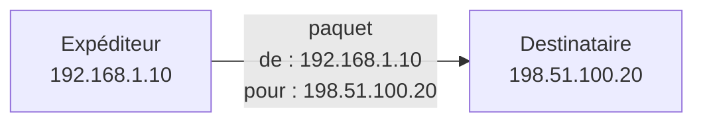
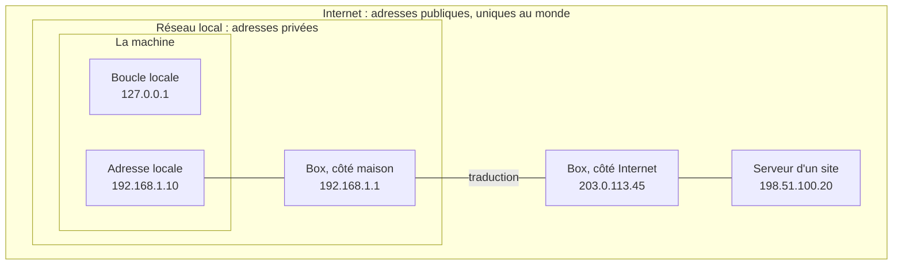
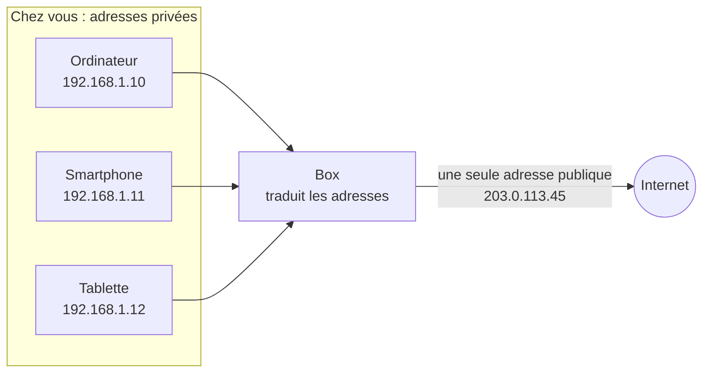

[← Chapitre précédent](02-Internet-reseau-de-reseaux.md) · [Sommaire](Readme.md) · [Chapitre suivant →](04-Nom-de-domaine.md)

# L'adresse IP

Sur un réseau, les informations sont découpées en petits morceaux appelés
**paquets**. Chaque paquet porte deux adresses, comme une enveloppe : celle de
l'**expéditeur** et celle du **destinataire**. Ce sont des **adresses IP**.



Les adresses IP n'ont pas toutes la même portée. Certaines ne servent qu'à
l'intérieur de la machine, d'autres seulement dans le réseau de la maison ou du
bureau, d'autres sur tout Internet.

---

## 1. Trois portées



### Dans la machine

L'adresse `127.0.0.1`, appelée aussi `localhost`, désigne la machine elle-même.
C'est la **boucle locale** : ce qui y est envoyé ne sort pas de la machine, même
sans câble ni Wi-Fi. Elle sert quand deux programmes du même ordinateur
communiquent entre eux.

### Dans le réseau local

Trois plages d'adresses sont réservées aux réseaux locaux. Ce sont les adresses
**privées** : celles qui commencent par `10.`, par `192.168.`, ou par `172.16.`
à `172.31.`. Chacun peut les utiliser chez soi, si bien que votre ordinateur et
celui de votre voisin ont peut-être la même. Ces adresses ne circulent pas sur
Internet. Chez vous, c'est la box qui les distribue automatiquement.

### Sur Internet

Une adresse **publique** est **unique au monde**. L'opérateur en attribue une à
chaque box.

---

## 2. La box traduit les adresses

Les machines de la maison ont des adresses privées, qui ne circulent pas sur
Internet. Quand un paquet sort, la box **remplace** l'adresse privée de
l'expéditeur par sa propre adresse publique. Quand la réponse revient, elle fait
l'opération inverse. C'est la **traduction d'adresse**, ou NAT.



Vue d'Internet, toute la maison (ou toute l'entreprise) utilise donc **une seule
adresse publique**.

---

## 3. L'adresse IPv4

L'adresse IP la plus répandue est l'**IPv4**. Elle s'écrit avec **quatre nombres
de 0 à 255**, séparés par des points. Pour la machine, cela représente 4 octets,
soit 32 bits.

```text
             192 . 168 . 1 . 10
             └─────┬─────┘   └┬┘
                réseau     machine
```

Elle se lit en deux parties, comme une adresse postale. Le début désigne le
**réseau**, comme le nom d'une rue. La fin désigne la **machine** dans ce
réseau, comme le numéro dans la rue. Le chapitre 5 explique comment savoir où
s'arrête la partie réseau.

32 bits permettent environ **4,3 milliards** d'adresses. Ce nombre paraissait
largement suffisant en 1981, quand IPv4 a été conçu. Il est aujourd'hui
inférieur au nombre d'appareils connectés.

---

## 4. Pourquoi IPv6

Il ne reste **plus d'adresses IPv4 publiques** à distribuer. Le stock mondial a
été épuisé en 2011, celui de l'Europe en 2019. La traduction d'adresse faite par
les box a permis de continuer, mais elle complique certains usages, par exemple
rendre une machine de la maison joignable depuis Internet.

La solution retenue est **IPv6**, une nouvelle version du protocole avec des
adresses beaucoup plus longues. Les numéros de téléphone français ont suivi la
même logique en passant de 8 à 10 chiffres en 1996.

---

## 5. L'adresse IPv6

Une adresse IPv6 compte **128 bits**, écrits en **8 groupes de 4 caractères**
hexadécimaux (les chiffres de 0 à 9 et les lettres de a à f), séparés par
deux-points :

```text
2001:0db8:0000:0000:0000:ff00:0042:8329
└──── réseau ─────┘ └──── machine ────┘
```

Pour l'écrire plus court, on supprime les zéros au début de chaque groupe, puis
on remplace **une** suite de groupes nuls par `::` :

```text
2001:db8::ff00:42:8329
```

Il y a assez d'adresses IPv6 pour en donner une publique à chaque appareil. La
traduction d'adresse n'est donc plus nécessaire : chaque machine a sa propre
adresse, et c'est le **pare-feu** de la box ou de l'entreprise qui décide de ce
qui peut entrer.

| | IPv4 | IPv6 |
| --- | --- | --- |
| Taille | 32 bits | 128 bits |
| Exemple | `192.168.1.10` | `2001:db8::1` |
| Nombre d'adresses | environ 4,3 milliards | environ 340 milliards de milliards de milliards de milliards |
| Boucle locale | `127.0.0.1` | `::1` |

Les deux versions sont utilisées en même temps : la plupart des machines ont à
la fois une adresse IPv4 et une adresse IPv6.

---

## L'essentiel

- Chaque paquet porte l'adresse IP de son expéditeur et celle de son
  destinataire.
- Il y a trois portées : la machine (`127.0.0.1`), le réseau local (adresses
  privées) et Internet (adresses publiques).
- La box remplace les adresses privées par son adresse publique.
- IPv4 s'écrit avec quatre nombres de 0 à 255, et ses adresses publiques sont
  épuisées.
- IPv6 utilise des adresses beaucoup plus longues, écrites en hexadécimal.

---

## Exercices

### Exercice 1 - Quelle portée ?

Classez ces adresses : `127.0.0.1`, `192.168.1.25`, `8.8.8.8`, `10.0.0.5`,
`::1`, `203.0.113.45`.

<details>
<summary>Voir la correction</summary>

- **La machine** : `127.0.0.1` et `::1`, la boucle locale.
- **Le réseau local** : `192.168.1.25` et `10.0.0.5`, des adresses privées.
- **Internet** : `8.8.8.8` et `203.0.113.45`, des adresses publiques.

</details>

### Exercice 2 - Deux maisons, une même adresse

Votre ordinateur et celui de votre voisin ont tous deux l'adresse
`192.168.1.10`. Est-ce un problème ?

<details>
<summary>Voir la correction</summary>

Non. Ce sont des adresses **privées**, dans deux réseaux séparés. Sur Internet,
chaque maison apparaît sous l'adresse **publique** de sa box, qui est unique.

</details>

---

[← Chapitre précédent](02-Internet-reseau-de-reseaux.md) · [Sommaire](Readme.md) · [Chapitre suivant →](04-Nom-de-domaine.md)
