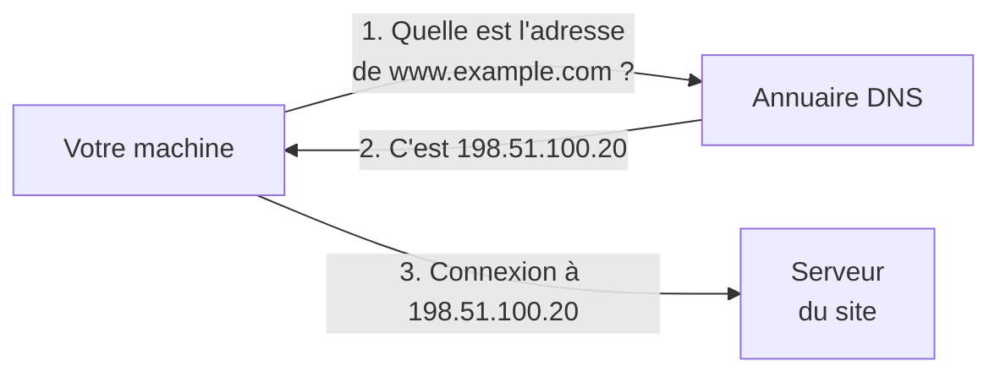
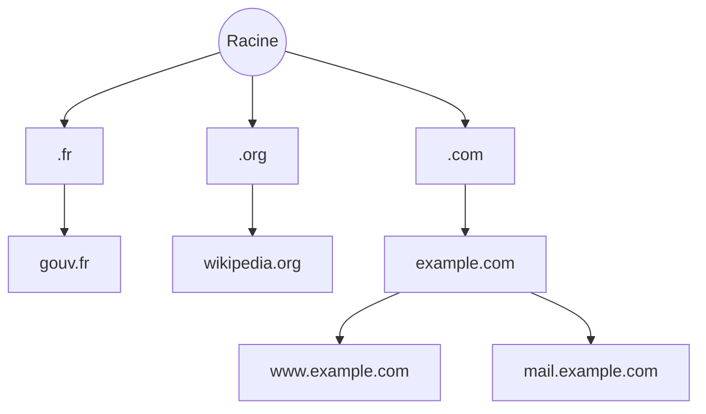
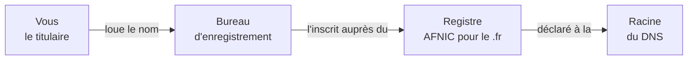
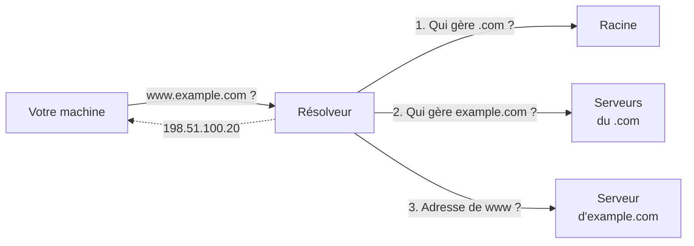
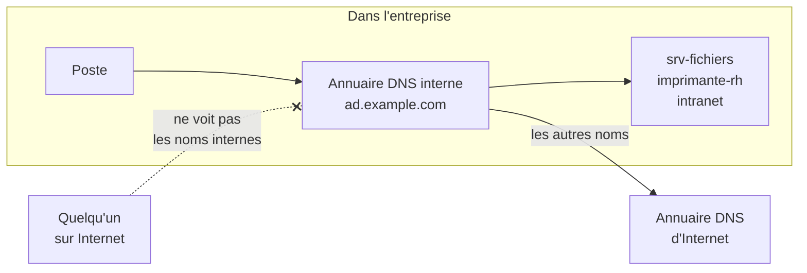

[← Chapitre précédent](03-Adresse-IP.md) · [Sommaire](Readme.md) · [Chapitre suivant →](05-Adresse-IPv4-et-masque.md)

# Le nom de domaine

Les machines se trouvent grâce à leur adresse IP, mais une adresse comme
`198.51.100.20` est difficile à retenir. On utilise plutôt un **nom**, comme
`www.example.com`. Le nom de domaine fait le lien entre les deux, comme le
répertoire d'un téléphone : on choisit "Maman" et le téléphone compose le
numéro.

Ce chapitre présente d'abord les noms de domaine d'**Internet**, visibles depuis
le monde entier, puis le **domaine local**, propre à une entreprise.

---

## 1. Un nom plutôt qu'une adresse

Avant de contacter un site, votre machine demande son adresse à un annuaire : le
**DNS** (*Domain Name System*).



Le nom a deux avantages sur l'adresse : il est facile à retenir, et il reste le
même quand le site change d'hébergeur et donc d'adresse IP.

---

## 2. Comment se lit un nom

Un nom de domaine se lit **de droite à gauche**, du plus général au plus
précis :

```text
www.example.com
 │     │     └── l'extension : .com, .fr, .org...
 │     └──────── le nom choisi par son propriétaire
 └────────────── un service de ce domaine : ici, le site Web
```

L'ensemble des noms forme un **arbre**. La **racine** est au sommet. En dessous
viennent les extensions, puis les domaines, puis les services de chaque
domaine :



---

## 3. Qui gère les noms

Un nom de domaine ne s'achète pas, il se **loue** pour une durée de un à dix
ans. On le loue auprès d'un **bureau d'enregistrement** (*registrar*), qui
l'inscrit auprès du **registre** de l'extension (l'AFNIC pour le `.fr`). Chaque
registre est lui-même déclaré à la racine.



Un nom qui n'est pas renouvelé redevient libre. Quelqu'un d'autre peut alors le
louer et recevoir les courriels envoyés à ce nom.

---

## 4. Le DNS, un annuaire réparti

Aucun serveur ne connaît tous les noms du monde. Les informations sont
réparties : la racine sait qui gère le `.com`, les serveurs du `.com` savent qui
gère `example.com`, et seul le serveur d'`example.com` connaît l'adresse de
`www.example.com`.

Votre machine ne fait pas elle-même toutes ces demandes. Elle interroge un
**résolveur** (celui de la box, de l'opérateur ou de l'entreprise), qui descend
l'arbre à sa place et **garde la réponse en mémoire** pour les demandes
suivantes.



---

## 5. Le domaine local, dans l'entreprise

Une entreprise donne aussi des noms à ses propres machines : serveurs,
imprimantes, intranet. Elle crée pour cela un **domaine local**, par exemple
`ad.example.com`, géré par **son propre annuaire DNS**. On y trouve des noms
comme `srv-fichiers.ad.example.com` ou `imprimante-rh.ad.example.com`.

L'annuaire interne répond lui-même pour les noms de l'entreprise et transmet les
autres demandes aux serveurs DNS d'Internet. Les noms internes ne sont pas
visibles depuis l'extérieur.



| | Nom de domaine Internet | Domaine local |
| --- | --- | --- |
| Visible depuis | le monde entier | l'entreprise seulement |
| Géré par | des serveurs publics | l'annuaire DNS interne |
| Loué auprès de | un bureau d'enregistrement | personne |
| Ce qu'il nomme | sites, messagerie | serveurs, postes, imprimantes |

---

## 6. À quoi sert le domaine local

Le domaine local sert d'abord à **nommer les ressources internes** : on se
connecte à `srv-fichiers` plutôt qu'à `10.0.1.20`.

Sous Windows, il sert aussi à faire fonctionner l'**annuaire de l'entreprise**,
Active Directory. Dans ce contexte, le mot "domaine" désigne l'ensemble des
utilisateurs, des postes et des serveurs gérés ensemble. Chaque utilisateur a
**un seul compte**, valable sur tous les postes. Un serveur central, le
**contrôleur de domaine**, vérifie les mots de passe et donne accès aux
ressources.


Les postes trouvent le contrôleur de domaine **grâce au DNS interne**. Si le DNS
interne ne répond pas, les utilisateurs ne peuvent pas ouvrir de session.

À la maison, il n'y a pas de domaine local de ce type. Les appareils se
signalent eux-mêmes sur le réseau avec un nom en `.local`, comme
`imprimante.local`, sans serveur DNS.

---

## 7. Domaine local et sécurité

- **Choisir le nom avec soin.** On utilise un sous-domaine d'un nom que
  l'entreprise possède, comme `ad.example.com`. On évite `.local`, déjà utilisé
  par les appareils qui se signalent eux-mêmes, et les extensions inventées
  comme `.lan` ou `.corp`, qui pourraient être créées un jour sur Internet.
- **Garder les noms internes pour soi.** La liste des noms internes décrit le
  réseau de l'entreprise : quels serveurs existent et à quoi ils servent.
  L'annuaire interne ne doit pas répondre aux demandes venant d'Internet.
- **Protéger l'annuaire.** Une personne qui modifie ses réponses peut envoyer les
  utilisateurs vers la machine de son choix. Seuls les administrateurs doivent
  pouvoir le modifier.
- **Configurer les postes avec l'annuaire interne.** Un poste réglé sur un
  annuaire public ne trouve plus le contrôleur de domaine et n'est plus soumis
  aux protections de l'entreprise.

---

## L'essentiel

- Le DNS traduit les noms en adresses IP, comme un répertoire téléphonique.
- Un nom se lit de droite à gauche. L'ensemble des noms forme un arbre qui part
  de la racine.
- Un nom se loue auprès d'un bureau d'enregistrement et doit être renouvelé.
- Le domaine local nomme les ressources de l'entreprise, n'est pas visible
  depuis Internet et fait fonctionner Active Directory.

---

## Exercices

### Exercice 1 - Le serveur introuvable

Depuis chez lui, un collaborateur tape `srv-fichiers.ad.example.com` et
n'obtient aucune réponse. Pourquoi ?

<details>
<summary>Voir la correction</summary>

Ce nom appartient au **domaine local**. Seul l'annuaire DNS de l'entreprise le
connaît, et il ne répond pas aux demandes venant d'Internet. Le collaborateur
doit d'abord se connecter au réseau de l'entreprise, par exemple avec un
**VPN**.

</details>

### Exercice 2 - Le nom du domaine local

Un administrateur propose de nommer le domaine de l'entreprise `example.local`.
Que lui répondez-vous ?

<details>
<summary>Voir la correction</summary>

`.local` est déjà utilisé par les appareils qui se signalent eux-mêmes sur le
réseau (imprimantes, Mac, smartphones), ce qui risque de créer des conflits. Il
vaut mieux utiliser un sous-domaine d'un nom que l'entreprise possède, comme
`ad.example.com`.

</details>

---

[← Chapitre précédent](03-Adresse-IP.md) · [Sommaire](Readme.md) · [Chapitre suivant →](05-Adresse-IPv4-et-masque.md)
