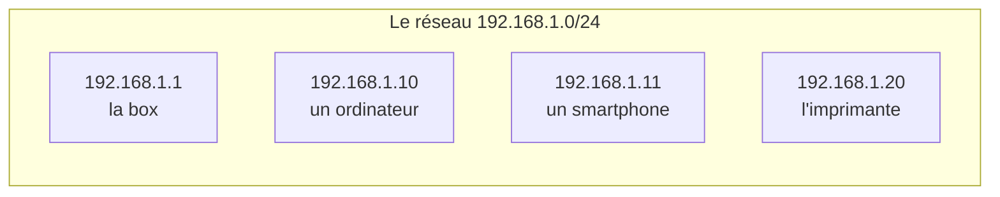
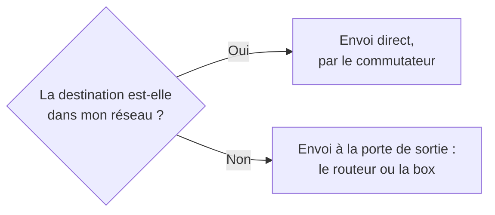

[← Chapitre précédent](04-Nom-de-domaine.md) · [Sommaire](Readme.md) · [Chapitre suivant →](06-Trouver-ses-adresses-IP.md)

# Une adresse IPv4 à la loupe

Une adresse IPv4 se lit en deux parties : le **réseau**, comme le nom d'une rue,
et la **machine**, comme le numéro dans la rue. Le **masque** indique où s'arrête
la partie réseau et où commence la partie machine.

---

## 1. Quatre nombres, 32 bits

Chacun des quatre nombres est un **octet**, c'est-à-dire 8 bits. De gauche à
droite, ces bits valent 128, 64, 32, 16, 8, 4, 2 et 1. On obtient le nombre en
additionnant les valeurs des bits qui sont à 1 :

| Valeur des bits | 128 | 64 | 32 | 16 | 8 | 4 | 2 | 1 |
| --- | --- | --- | --- | --- | --- | --- | --- | --- |
| 192 = 128 + 64 | 1 | 1 | 0 | 0 | 0 | 0 | 0 | 0 |
| 255 : tous les bits | 1 | 1 | 1 | 1 | 1 | 1 | 1 | 1 |

Quand tous les bits sont à 1, on obtient 255 : c'est le plus grand nombre
possible dans un octet.

---

## 2. Le masque

Le masque accompagne toujours l'adresse. Là où il vaut **255**, les nombres de
l'adresse désignent le **réseau**. Là où il vaut **0**, ils désignent la
**machine**.

```text
Adresse :   192 . 168 .   1 .  10
Masque  :   255 . 255 . 255 .   0
            └── réseau ───┘   └─┘ machine
```

Ce masque s'écrit aussi **/24** : les 24 premiers bits de l'adresse désignent
le réseau. On note donc l'adresse `192.168.1.10/24`.

---

## 3. Ce que l'on en déduit

Dans le réseau `192.168.1.0/24`, toutes les adresses commencent par
`192.168.1`. Seul le dernier nombre change d'une machine à l'autre.



- `192.168.1.0` désigne le réseau lui-même ;
- `192.168.1.255` s'adresse à toutes les machines du réseau à la fois ;
- de `192.168.1.1` à `192.168.1.254` : **254 adresses** pour les machines.

Avec un masque `255.255.0.0`, ou `/16`, seuls les deux premiers nombres
désignent le réseau, qui peut alors contenir plus de 65 000 machines.

---

## 4. À quoi sert le masque

Avant chaque envoi, une machine compare la partie réseau de la destination avec
la sienne :



Cette porte de sortie s'appelle la **passerelle par défaut**. Si le masque est
mal réglé, la comparaison est fausse : la machine envoie à la passerelle des
paquets destinés à ses voisines, ou l'inverse, et certaines communications
échouent.

---

## Exercices

### Exercice 1 - Même réseau ?

Les machines `192.168.1.20/24` et `192.168.2.30/24` peuvent-elles se parler
directement ?

<details>
<summary>Voir la correction</summary>

**Non.** Avec un masque `/24`, les trois premiers nombres désignent le réseau :
`192.168.1` d'un côté, `192.168.2` de l'autre. Ce sont deux réseaux différents :
il faut passer par un routeur.

</details>

### Exercice 2 - Le bon voisin

Une machine a l'adresse `10.0.5.12` et le masque `255.255.255.0`. Parmi
`10.0.5.200`, `10.0.6.12` et `10.0.5.1`, lesquelles sont dans son réseau ?

<details>
<summary>Voir la correction</summary>

Son réseau est `10.0.5` : **`10.0.5.200`** et **`10.0.5.1`** en font partie.
`10.0.6.12` est dans un autre réseau.

</details>

---

[← Chapitre précédent](04-Nom-de-domaine.md) · [Sommaire](Readme.md) · [Chapitre suivant →](06-Trouver-ses-adresses-IP.md)
