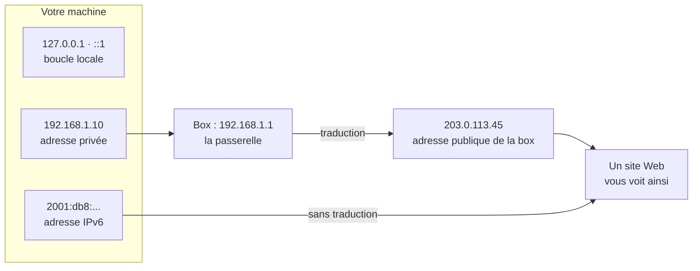

[← Chapitre précédent](05-Adresse-IPv4-et-masque.md) · [Sommaire](Readme.md) · [Chapitre suivant →](07-Traceroute.md)

# Trouver ses adresses IP

Votre machine possède **plusieurs adresses IP en même temps**. Dans ce chapitre,
vous allez les retrouver et les situer sur le schéma ci-dessous.



Les commandes sont données pour Windows, Linux et macOS. Elles affichent des
informations et ne modifient rien sur le poste.

---

## 1. Afficher ses adresses

### Windows

Dans l'invite de commandes ou PowerShell :

```powershell
ipconfig /all
```

Extrait, simplifié :

```text
Carte réseau sans fil Wi-Fi :
   Adresse IPv6. . . . . . . . . . . . . .: 2001:db8:1234:5600::1a2b
   Adresse IPv6 de liaison locale. . . . .: fe80::8d4f:2a1b:9c3e:71f2%12
   Adresse IPv4. . . . . . . . . . . . . .: 192.168.1.10
   Masque de sous-réseau. . . . . . . . . : 255.255.255.0
   Passerelle par défaut. . . . . . . . . : 192.168.1.1
   Serveurs DNS. . . . . . . . . . . . .  : 192.168.1.1
```

`ipconfig` n'affiche pas la boucle locale. Pour voir toutes les adresses, y
compris `127.0.0.1` et `::1`, utilisez cette commande PowerShell :

```powershell
Get-NetIPAddress | Format-Table InterfaceAlias, IPAddress
```

### Linux

```bash
ip address
```

Extrait :

```text
1: lo: <LOOPBACK,UP,LOWER_UP>
    inet 127.0.0.1/8 scope host lo
    inet6 ::1/128 scope host
2: enp0s3: <BROADCAST,MULTICAST,UP,LOWER_UP>
    inet 192.168.1.10/24 brd 192.168.1.255 scope global enp0s3
    inet6 2001:db8:1234:5600:21a:2bff:fe3c:4d5e/64 scope global
    inet6 fe80::21a:2bff:fe3c:4d5e/64 scope link
```

### macOS

Dans l'application Terminal :

```bash
ifconfig
```

Extrait :

```text
lo0: flags=8049<UP,LOOPBACK,RUNNING,MULTICAST>
    inet 127.0.0.1 netmask 0xff000000
    inet6 ::1 prefixlen 128
en0: flags=8863<UP,BROADCAST,SMART,RUNNING,SIMPLEX,MULTICAST>
    inet 192.168.1.10 netmask 0xffffff00 broadcast 192.168.1.255
    inet6 2001:db8:1234:5600:1c2a:5bff:fe3c:4d5e prefixlen 64 autoconf
    inet6 fe80::1c2a:5bff:fe3c:4d5e%en0 prefixlen 64
```

Chaque système écrit le masque à sa façon : `255.255.255.0` sous Windows, `/24`
sous Linux, `0xffffff00` sous macOS. Les trois écritures désignent le même
masque.

---

## 2. Ranger ses adresses

Complétez le tableau avec ce que vous avez trouvé :

| Adresse | IPv4 ou IPv6 | Portée : machine, réseau local ou Internet |
| --- | --- | --- |
| | | |
| | | |
| | | |
| | | |

<details>
<summary>Voir un exemple rempli</summary>

| Adresse | Version | Portée |
| --- | --- | --- |
| `127.0.0.1` et `::1` | IPv4 et IPv6 | la machine : boucle locale |
| `192.168.1.10` | IPv4 | réseau local : adresse privée |
| `fe80::...` | IPv6 | le réseau local seulement |
| `2001:db8:...` | IPv6 | Internet : adresse publique |

</details>

Vous trouverez peut-être d'autres cartes réseau, créées par un **VPN**, une
**machine virtuelle** ou **Docker**. Chacune correspond à un réseau séparé, avec
ses propres adresses.

---

## 3. Trouver sa passerelle

La passerelle est la porte de sortie du réseau local. À la maison, c'est en
général la box.

```powershell
# Windows : ligne "Passerelle par défaut"
ipconfig
```

```bash
# Linux : ligne "default via ..."
ip route
```

```bash
# macOS : ligne "gateway"
route -n get default
```

---

## 4. Trouver son adresse publique

Les adresses IPv4 de votre machine sont privées. Sur Internet, vous apparaissez
sous l'adresse publique de la box. Pour la connaître, on interroge un site qui
renvoie l'adresse sous laquelle il vous voit :

```powershell
# Windows : écrire curl.exe, car dans PowerShell "curl" est une autre commande
curl.exe -4 ifconfig.me
curl.exe -6 ifconfig.me
```

```bash
# Linux et macOS
curl -4 ifconfig.me
curl -6 ifconfig.me
```

Comparez le résultat avec les adresses de votre machine :

- en **IPv4**, l'adresse obtenue est **différente** de celle de votre machine,
  car la box a traduit l'adresse ;
- en **IPv6**, l'adresse obtenue est **l'une de celles de votre machine**, car il
  n'y a pas de traduction. Si la commande échoue, votre réseau ne fournit pas
  d'IPv6.

---

## 5. Tester la boucle locale

Coupez le Wi-Fi ou débranchez le câble, puis :

```powershell
# Windows
ping 127.0.0.1
```

```bash
# Linux et macOS : Ctrl+C pour arrêter
ping 127.0.0.1
```

La commande reçoit des réponses même sans réseau : la machine se répond à
elle-même.

---

## Exercices

### Exercice 1 - Une adresse étrange

Un poste affiche l'adresse `169.254.37.12`. Que s'est-il passé ?

<details>
<summary>Voir la correction</summary>

Le poste n'a pas reçu d'adresse de la box ou du serveur de l'entreprise. Il
s'est attribué lui-même une adresse en `169.254.x.x`, qui ne permet pas de
sortir du réseau local. Il faut vérifier le câble ou le Wi-Fi, puis la box.

</details>

### Exercice 2 - Deux adresses pour un même poste

`ipconfig` affiche `192.168.1.10`, mais `ifconfig.me` renvoie `203.0.113.45`.
Laquelle est la bonne ?

<details>
<summary>Voir la correction</summary>

Les deux sont correctes. `192.168.1.10` est l'adresse **privée** du poste dans
le réseau local. `203.0.113.45` est l'adresse **publique** de la box, utilisée
par toutes les machines de la maison quand elles vont sur Internet.

</details>

---

[← Chapitre précédent](05-Adresse-IPv4-et-masque.md) · [Sommaire](Readme.md) · [Chapitre suivant →](07-Traceroute.md)
