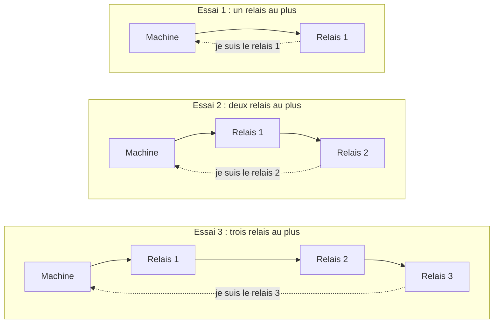
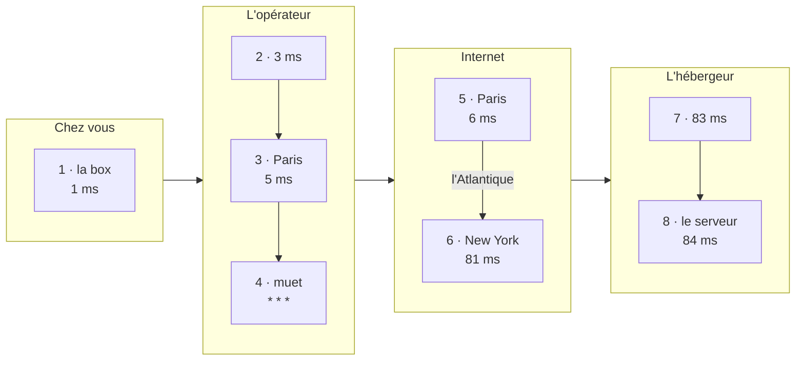

[← Chapitre précédent](06-Trouver-ses-adresses-IP.md) · [Sommaire](Readme.md) · [Chapitre suivant →](08-Conclusion.md)

# Traceroute : par où ça passe ?

Le chapitre 1 a décrit le chemin entre votre machine et Internet. La commande
`traceroute` permet de l'observer : elle affiche un par un les relais traversés
pour atteindre une destination, avec le temps de réponse de chacun.

---

## 1. Le principe

Chaque paquet porte un **compteur de relais**. Chaque routeur qui transmet le
paquet diminue ce compteur de 1. Quand le compteur arrive à zéro, le routeur
supprime le paquet et prévient l'expéditeur. Ce mécanisme empêche un paquet mal
acheminé de circuler sans fin.

`traceroute` utilise ce mécanisme. Il envoie d'abord un paquet qui ne peut
franchir qu'**un** relais, puis un paquet qui peut en franchir **deux**, puis
**trois**, et ainsi de suite. Chaque relais qui supprime un paquet répond à
l'expéditeur, ce qui permet de l'identifier.



Les essais continuent jusqu'à ce que le paquet atteigne la destination.

---

## 2. Lancer la commande

```powershell
# Windows
tracert www.wikipedia.org
```

```bash
# Linux : si traceroute n'est pas installé, tracepath fait la même chose
traceroute www.wikipedia.org
```

```bash
# macOS
traceroute www.wikipedia.org
```

---

## 3. Lire le résultat

Voici une trace fictive, lancée depuis un domicile en France vers un serveur
situé aux États-Unis :

```text
  1     1 ms     1 ms     1 ms  192.168.1.1
  2     3 ms     3 ms     4 ms  203.0.113.1
  3     5 ms     4 ms     5 ms  core1.par.operateur.example [192.0.2.10]
  4     *        *        *     Délai d'attente de la demande dépassé.
  5     6 ms     5 ms     6 ms  edge1.par.transit.example [192.0.2.141]
  6    81 ms    80 ms    81 ms  core2.nyc.transit.example [192.0.2.77]
  7    83 ms    82 ms    83 ms  gw.hebergeur.example [198.51.100.1]
  8    84 ms    83 ms    84 ms  www.example.com [198.51.100.20]
```

Chaque ligne correspond à un relais, et les trois temps correspondent à trois
essais. Voici les mêmes relais placés sur le chemin du chapitre 1 :



Pour lire une trace, on regarde :

- **les adresses** : la première est une adresse privée, c'est la box ;
- **les noms** : ils contiennent souvent un code de ville (`par` pour Paris,
  `nyc` pour New York, `fra` pour Francfort) ;
- **les temps** : une forte augmentation indique une longue distance. Ici, le
  temps passe de 6 à 81 ms entre les relais 5 et 6, ce qui correspond à la
  traversée de l'Atlantique par les câbles sous-marins.

---

## 4. Les étoiles

Une ligne `* * *` signifie qu'un relais **n'a pas répondu**. Beaucoup de
routeurs sont configurés pour ne pas répondre à `traceroute`. Si les lignes
suivantes répondent, le chemin fonctionne normalement.

Si les étoiles continuent **jusqu'à la fin**, un pare-feu bloque probablement
`traceroute`. C'est fréquent en entreprise, même quand les sites s'ouvrent
normalement dans le navigateur.

---

## 5. Manipulations

1. Lancez la commande vers l'adresse de votre box. Combien de relais
   voyez-vous ?
2. Lancez-la vers `www.wikipedia.org`. Repérez la box, puis le réseau de votre
   opérateur.
3. Lancez-la vers un site hébergé sur un autre continent, par exemple celui
   d'une université japonaise ou australienne. À quel relais le temps
   augmente-t-il fortement ?

Si un site lointain répond rapidement et en peu de relais, une **copie** du site
est probablement servie depuis un relais de contenus proche de vous
(chapitre 2).

---

## Exercices

### Exercice 1 - Lire une trace

Dans une trace, les relais 1 à 4 répondent en moins de 10 ms, le relais 5
affiche `* * *`, et les relais 6 à 12 répondent vers 150 ms. Que concluez-vous ?

<details>
<summary>Voir la correction</summary>

- Le relais 5 ne répond pas, mais les suivants répondent : le chemin fonctionne,
  ce relais est simplement configuré pour ne pas répondre.
- Le passage de 10 à 150 ms indique une **très longue distance** : la
  destination se trouve sur un autre continent.

</details>

---

[← Chapitre précédent](06-Trouver-ses-adresses-IP.md) · [Sommaire](Readme.md) · [Chapitre suivant →](08-Conclusion.md)
