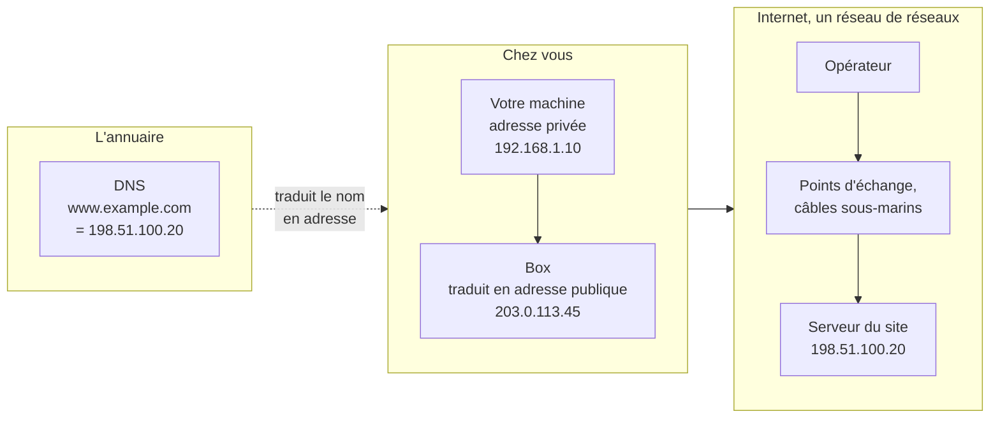

[← Chapitre précédent](07-Traceroute.md) · [Sommaire](Readme.md)

# Conclusion

Ce module a suivi le trajet d'une information, depuis votre machine jusqu'au
serveur d'un site situé ailleurs sur Internet. Le schéma suivant résume les
notions rencontrées en chemin.

---

## Ce qu'il faut retenir

- **Le réseau** relie des machines qui suivent des règles communes. Le
  commutateur relie les machines du réseau local, le routeur en est la porte de
  sortie et la box le raccorde à l'opérateur.
- **Internet** est formé de réseaux reliés entre eux dans des points d'échange
  et, entre les continents, par des câbles sous-marins.
- **L'adresse IP** a trois portées : la machine (`127.0.0.1`), le réseau local
  (adresses privées) et Internet (adresses publiques). La box remplace les
  adresses privées par son adresse publique. Les adresses IPv4 publiques sont
  épuisées, et IPv6 apporte beaucoup plus d'adresses.
- **Le nom de domaine** est traduit en adresse IP par le DNS. En entreprise, un
  domaine local nomme les ressources internes et n'est pas visible depuis
  Internet.
- **Le masque** indique quelle partie de l'adresse désigne le réseau. Il permet
  à la machine de savoir si elle peut joindre directement une destination ou si
  elle doit passer par la passerelle.
- **Les commandes** vues en pratique permettent de vérifier ces notions sur sa
  propre machine.

---

## Les commandes du module

| Besoin | Windows | Linux | macOS |
| --- | --- | --- | --- |
| Voir ses adresses | `ipconfig /all` | `ip address` | `ifconfig` |
| Voir sa passerelle | `ipconfig` | `ip route` | `route -n get default` |
| Voir son adresse publique | `curl.exe -4 ifconfig.me` | `curl -4 ifconfig.me` | `curl -4 ifconfig.me` |
| Voir le chemin | `tracert site` | `traceroute site` | `traceroute site` |

---

## La suite du parcours

Ces notions seront reprises et approfondies dans les modules suivants : les
réseaux locaux et leur découpage, le routage, les services comme le DNS et
l'annuaire de l'entreprise, puis la sécurité.

---

## Pour vérifier

1. Quel équipement est la porte de sortie du réseau local ?
2. Pourquoi deux maisons peuvent-elles utiliser la même adresse
   `192.168.1.10` ?
3. Par où passe l'essentiel du trafic entre les continents ?
4. À quoi sert le DNS ?
5. Pourquoi les noms du domaine local ne sont-ils pas visibles depuis Internet ?
6. Que signifie une ligne `* * *` dans une trace ?

Voir la correction

1. Le **routeur**. À la maison, c'est la box qui joue ce rôle.
2. Ce sont des adresses **privées**, utilisées dans deux réseaux séparés. Sur
   Internet, chaque maison apparaît sous l'adresse publique de sa box.
3. Par les **câbles sous-marins**.
4. À traduire un **nom** de domaine en **adresse IP**.
5. Seul l'**annuaire DNS interne** de l'entreprise les connaît, et il ne répond
   pas aux demandes venant d'Internet.
6. Un relais **n'a pas répondu**. Si les relais suivants répondent, le chemin
   fonctionne.

---

[← Chapitre précédent](07-Traceroute.md) · [Sommaire](Readme.md)
