<style>
/* Centre les schémas et réduit les lignes de crédit (paragraphe tout en italique).
   Règles indépendantes du fond : valables en sombre comme en clair. */
section > p:has(> img) { text-align: center; }
section > p:has(> em:only-child) { font-size: 0.5em; text-align: center; }
</style>

# Les fondamentaux des réseaux

### Mise en jambe · parcours TSSR et AIS

<!-- Tour de table : qui a déjà configuré une box, un réseau d'entreprise ?
     S'appuyer sur les profils expérimentés pour les exemples de terrain. -->

---

## 🎯 Objectifs

À la fin de ce module, vous saurez :

1. Expliquer ce qu'est un réseau, de votre machine jusqu'à Internet
2. Expliquer pourquoi Internet est un réseau de réseaux
3. Distinguer les adresses IP de la machine, du réseau local et d'Internet
4. Expliquer ce qu'est un nom de domaine, sur Internet et en entreprise
5. Retrouver vos adresses IP et le chemin de vos données

---

## Le programme

1. Qu'est-ce qu'un réseau ?
2. Internet, un réseau de réseaux
3. L'adresse IP
4. Le nom de domaine
5. **Pause**
6. Une adresse IPv4 à la loupe
7. Trouver ses adresses IP
8. Traceroute : par où ça passe ?
9. Conclusion

---

# 1. Qu'est-ce qu'un réseau ?

---

## Qu'est-ce qu'un réseau ?

Un réseau relie des **machines** pour qu'elles **échangent des informations**.

| Sur la route | Sur le réseau |
|---|---|
| les maisons | les machines |
| les routes | les câbles, la fibre, le Wi-Fi |
| les carrefours, les panneaux | les équipements réseau |
| le code de la route | les **protocoles** |

---

## Le plus petit des réseaux

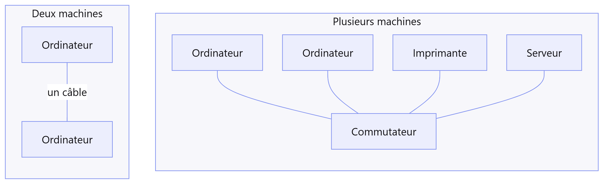

Deux machines reliées par un câble forment déjà un réseau. Au-delà de deux, on
les relie à un **commutateur**.

---

## Le réseau local

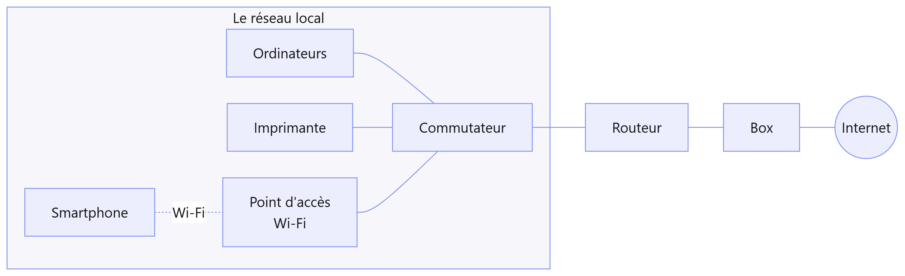

---

## Le rôle des équipements

- **Commutateur** : relie les machines du réseau local entre elles
- **Point d'accès Wi-Fi** : le même rôle, pour les appareils sans fil
- **Routeur** : la **porte de sortie** du réseau local
- **Box** : le raccordement à l'opérateur

> À la maison, la box regroupe tous ces rôles. En entreprise, chaque rôle a son
> équipement.

---

## De la box à l'opérateur

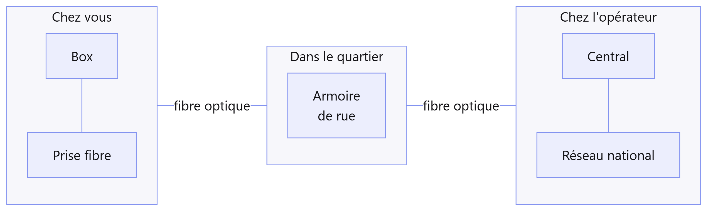

Le plus souvent par fibre optique, parfois par la ligne en cuivre (ADSL) ou par
le réseau 4G/5G. L'opérateur attribue à la box son **adresse publique**.

---

## De l'opérateur à Internet

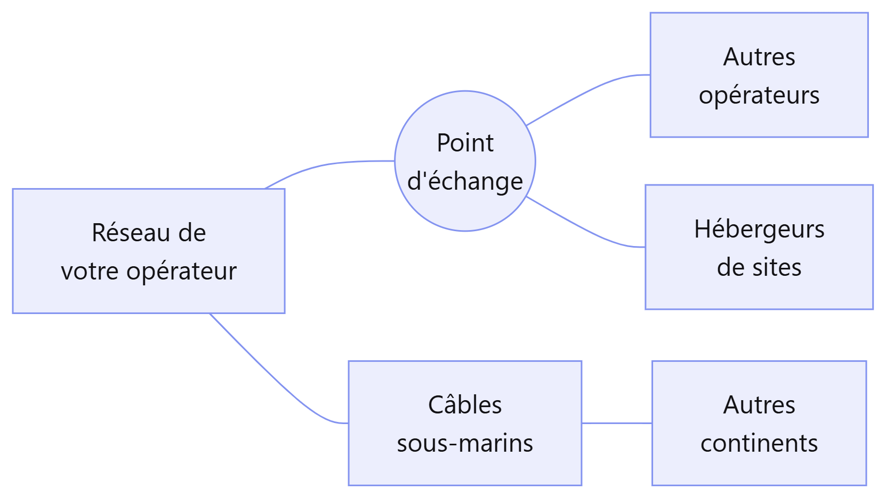

---

## Le chemin complet

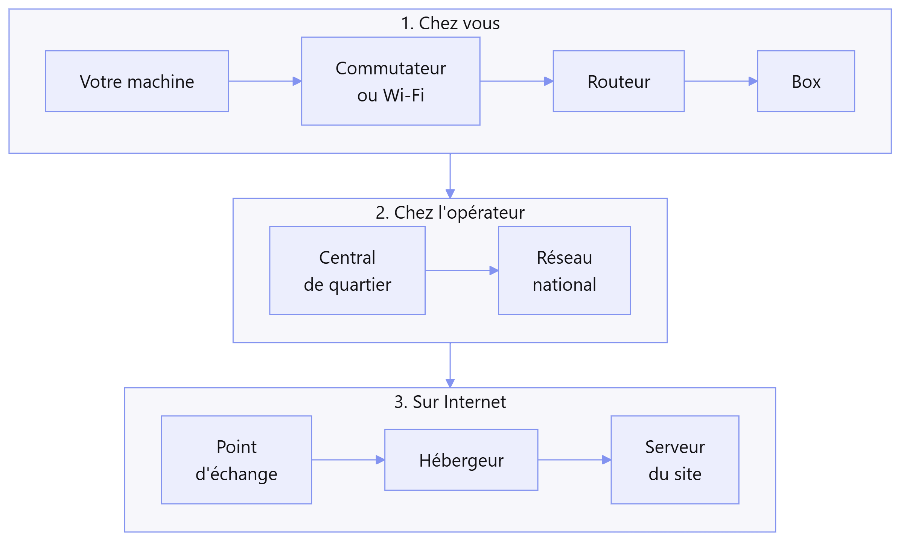

<!-- Comparer à un colis qui passe par plusieurs centres de tri : chaque
     équipement sait seulement à qui transmettre ensuite. Ce chemin sera
     observé avec traceroute dans la seconde partie. -->

---

# 2. Internet, un réseau de réseaux

---

## Un réseau de réseaux

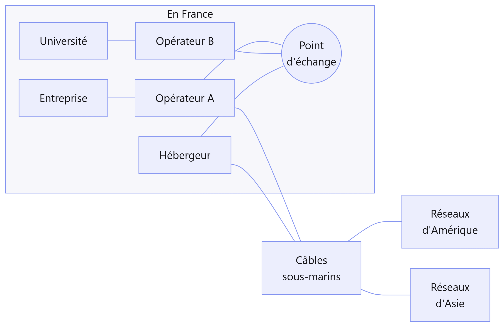

---

## Des réseaux indépendants

- Des **dizaines de milliers** de réseaux : opérateurs, hébergeurs, entreprises,
  universités
- Ils se relient dans des **points d'échange**, surtout à Paris et à Marseille
- Ils utilisent tous le même protocole : **IP**

> Internet et le Web sont différents : le Web est un des services qui utilisent
> Internet.

---

## Les relais : datacenters et copies de contenus

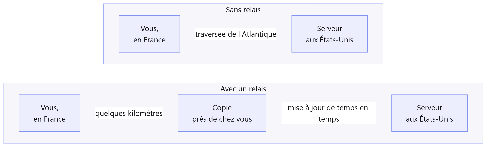

Les **datacenters** hébergent les serveurs. Des **copies** des contenus les plus
demandés sont placées près des utilisateurs.

---

## Les câbles sous-marins

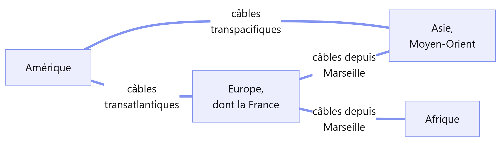

Presque tout le trafic entre continents passe **au fond des océans**.

---

## Les câbles sous-marins dans le monde

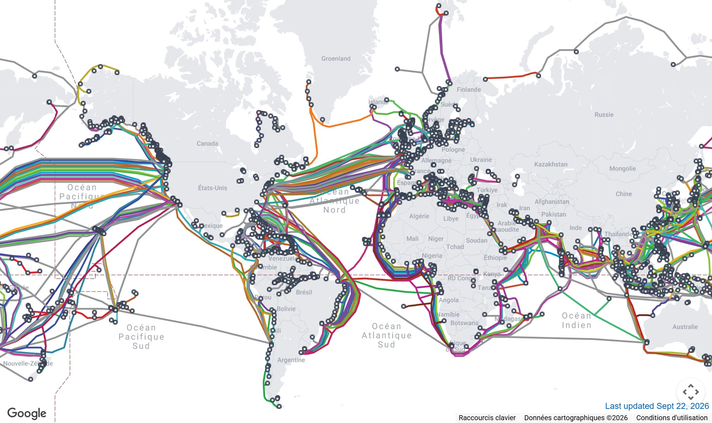

*Carte : TeleGeography, submarinecablemap.com, CC BY-SA 4.0. Fond © Google.*

---

## Les câbles qui arrivent en France

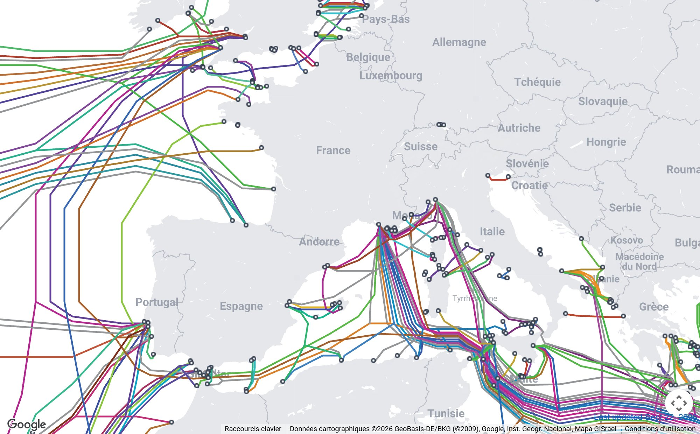

*Carte : TeleGeography, submarinecablemap.com, CC BY-SA 4.0. Fond © Google.*

<!-- Montrer les deux arrivées principales : la Bretagne et la côte atlantique
     pour l'Amérique, Marseille pour la Méditerranée, l'Afrique et l'Asie. -->

---

## Les câbles sous-marins en chiffres

- **Plus de 500** câbles en service ou en projet
- Au fond de l'océan, le diamètre d'un **tuyau d'arrosage**
- Un **répéteur** tous les 50 à 100 km pour amplifier le signal
- **Marseille**, l'un des principaux points d'arrivée au monde
- Principales causes de coupure : les **ancres** et les **chaluts**

Les satellites ne transportent qu'une petite part du trafic.

---

# 3. L'adresse IP

---

## Une adresse sur chaque paquet

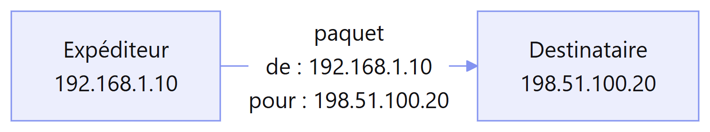

Les informations sont découpées en **paquets**. Chaque paquet porte l'adresse de
l'**expéditeur** et celle du **destinataire**.

---

## Trois portées

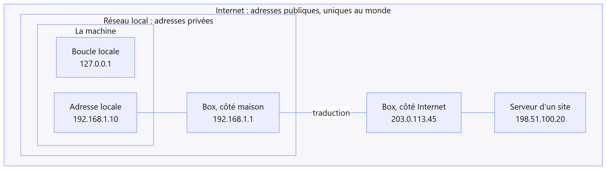

---

## Les trois portées

| Portée | Exemple | Usage |
|---|---|---|
| **La machine** | `127.0.0.1` | communication interne à la machine |
| **Le réseau local** | `192.168.1.10` | adresses **privées**, utilisées dans chaque réseau local |
| **Internet** | `203.0.113.45` | adresses **publiques**, uniques au monde |

Adresses privées : celles qui commencent par `10.`, `192.168.`, ou `172.16.` à
`172.31.`

---

## La box traduit les adresses

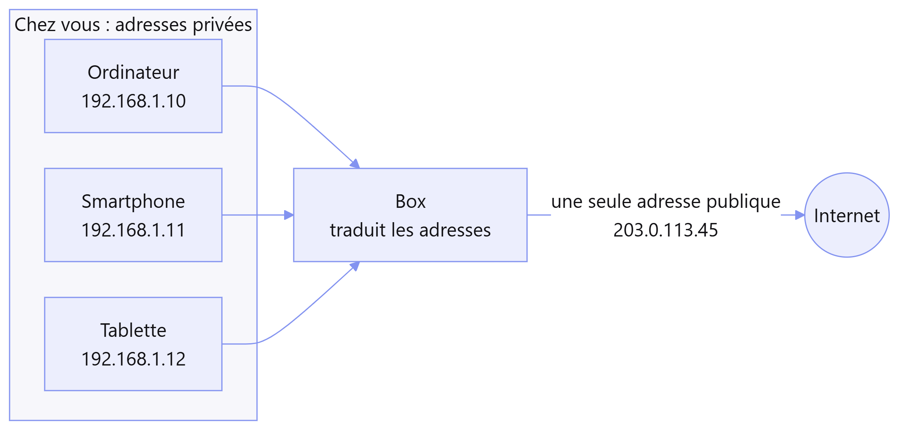

Toute la maison utilise **une seule adresse publique** sur Internet. C'est la
traduction d'adresse, ou **NAT**.

---

## L'adresse IPv4

```text
             192 . 168 . 1 . 10
             └─────┬─────┘   └┬┘
                réseau     machine
```

- **Quatre nombres** de 0 à 255, soit 32 bits
- Le début désigne le **réseau** (la rue), la fin la **machine** (le numéro)
- Environ **4,3 milliards** d'adresses

---

## Pourquoi IPv6

- Il ne reste **plus d'adresses IPv4** publiques : stock épuisé en 2011 dans le
  monde, en 2019 en Europe
- La traduction d'adresse permet de continuer, mais complique certains usages
- IPv6 utilise des adresses **beaucoup plus longues**

> Même logique que les numéros de téléphone français, passés de 8 à 10 chiffres
> en 1996.

---

## L'adresse IPv6

```text
2001:0db8:0000:0000:0000:ff00:0042:8329   →   2001:db8::ff00:42:8329
```

| | IPv4 | IPv6 |
|---|---|---|
| Taille | 32 bits | 128 bits |
| Exemple | `192.168.1.10` | `2001:db8::1` |
| Nombre | 4,3 milliards | 340 milliards de milliards de milliards de milliards |
| Boucle locale | `127.0.0.1` | `::1` |

Chaque machine a sa propre adresse publique. Le **pare-feu** filtre ce qui entre.

---

# 4. Le nom de domaine

---

## Un nom plutôt qu'une adresse

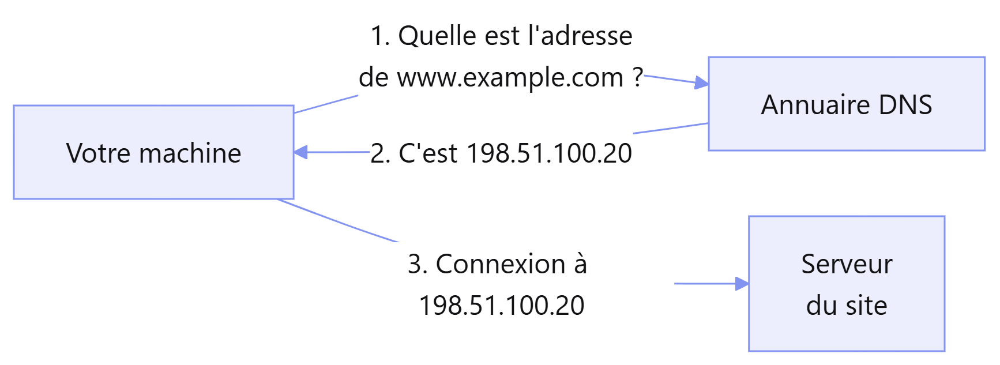

Le **DNS** fonctionne comme le répertoire d'un téléphone : on donne un nom, il
fournit le numéro.

---

## Comment se lit un nom

```text
www.example.com
 │     │     └── l'extension : .com, .fr, .org...
 │     └──────── le nom choisi par son propriétaire
 └────────────── un service de ce domaine : ici, le site Web
```

On lit **de droite à gauche**, du plus général au plus précis.

---

## L'arbre des noms

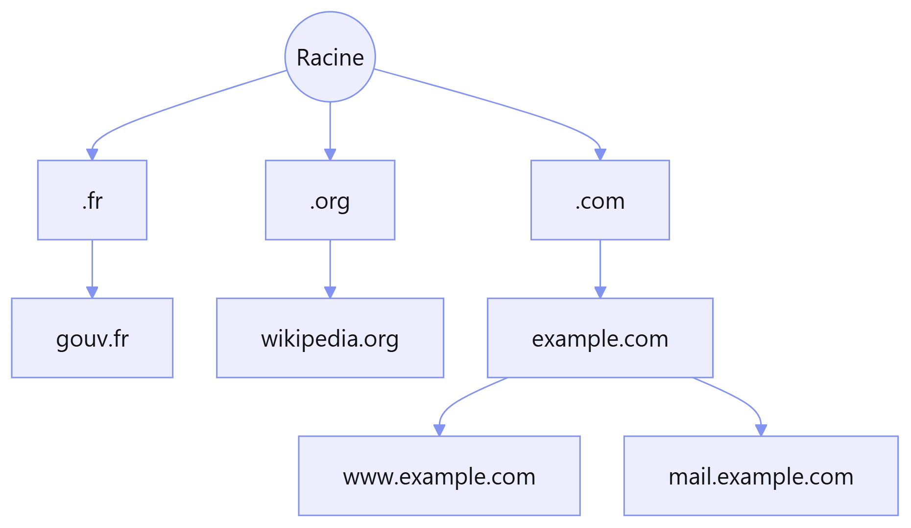

---

## Qui gère les noms

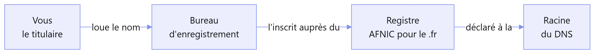

- Un nom se **loue** pour une durée de un à dix ans
- S'il n'est pas renouvelé, il redevient libre et quelqu'un d'autre peut le
  louer

---

## Le DNS, un annuaire réparti

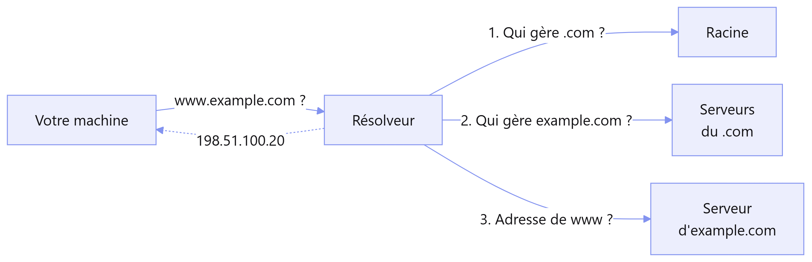

Le **résolveur** fait ces demandes à votre place et **garde la réponse en
mémoire**.

---

## Le domaine local, dans l'entreprise

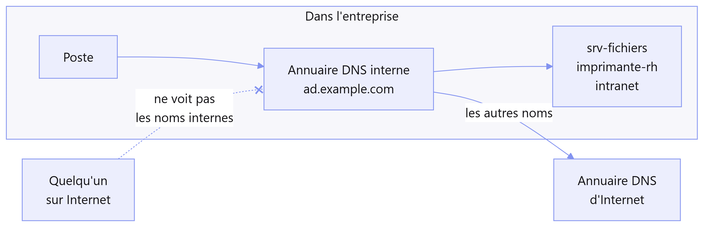

Un annuaire DNS **interne**, par exemple `ad.example.com`, qui n'est pas visible
depuis Internet.

---

## Domaine Internet et domaine local

| | Nom de domaine Internet | Domaine local |
|---|---|---|
| Visible depuis | le monde entier | l'entreprise seulement |
| Géré par | des serveurs publics | l'annuaire DNS interne |
| Loué auprès de | un bureau d'enregistrement | personne |
| Ce qu'il nomme | sites, messagerie | serveurs, postes, imprimantes |

---

## À quoi sert le domaine local

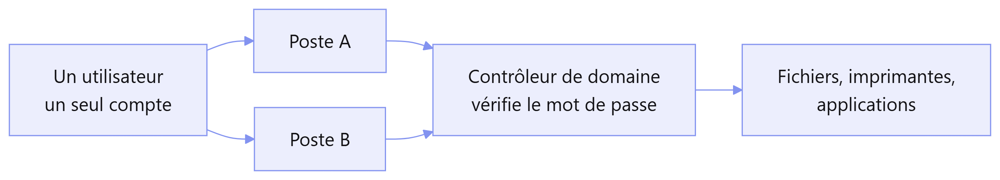

- Nommer les ressources internes : `srv-fichiers` plutôt que `10.0.1.20`
- Faire fonctionner **Active Directory** : un compte par utilisateur, vérifié par
  le **contrôleur de domaine**, que les postes trouvent **grâce au DNS**

---

## Domaine local et sécurité

- **Choisir le nom avec soin** : un sous-domaine d'un nom possédé
  (`ad.example.com`), ni `.local` ni extension inventée
- **Ne pas publier les noms internes** : ils décrivent le réseau de l'entreprise
- **Protéger l'annuaire** : en modifiant ses réponses, on peut détourner les
  utilisateurs
- **Configurer les postes** avec l'annuaire interne

---

# Pause

### Seconde partie : la pratique

---

# 5. Une adresse IPv4 à la loupe

---

## Quatre nombres, 32 bits

| Valeur des bits | 128 | 64 | 32 | 16 | 8 | 4 | 2 | 1 |
|---|---|---|---|---|---|---|---|---|
| 192 = 128 + 64 | 1 | 1 | 0 | 0 | 0 | 0 | 0 | 0 |
| 255 | 1 | 1 | 1 | 1 | 1 | 1 | 1 | 1 |

Chaque nombre tient sur un **octet** (8 bits). Le plus grand nombre possible est
255.

---

## Le masque

```text
Adresse :   192 . 168 .   1 .  10
Masque  :   255 . 255 . 255 .   0
            └── réseau ───┘   └─┘ machine
```

- **255** : partie réseau ; **0** : partie machine
- `255.255.255.0` s'écrit aussi **/24** : `192.168.1.10/24`

---

## Le réseau 192.168.1.0/24

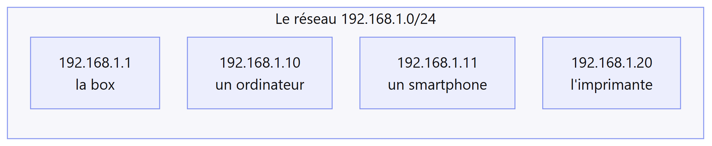

- `192.168.1.0` : le réseau lui-même
- `192.168.1.255` : toutes les machines à la fois
- De `.1` à `.254` : **254 adresses** pour les machines

---

## Dans mon réseau ou ailleurs

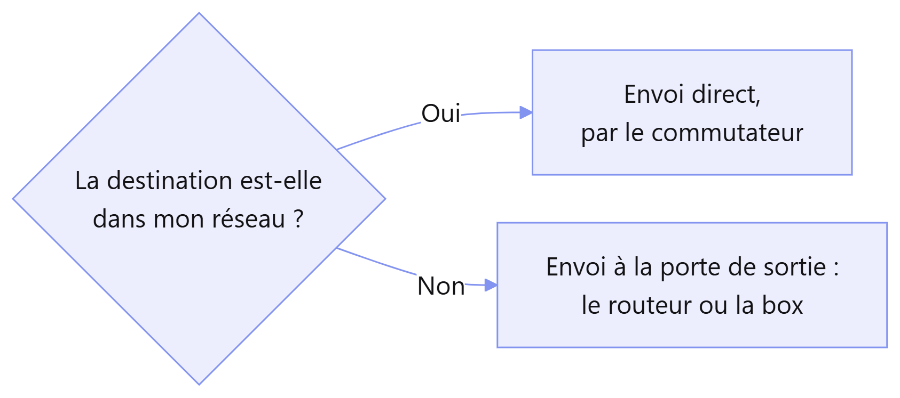

La porte de sortie s'appelle la **passerelle par défaut**.

---

# 6. Trouver ses adresses IP

---

## Ce que vous allez trouver

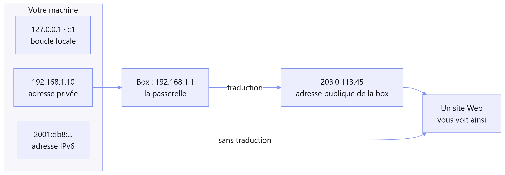

---

## Afficher ses adresses

| Windows | Linux | macOS |
|---|---|---|
| `ipconfig /all` | `ip address` | `ifconfig` |

Sous Windows, pour voir aussi la boucle locale :

```powershell
Get-NetIPAddress | Format-Table InterfaceAlias, IPAddress
```

Selon le système, le masque s'affiche `255.255.255.0`, `/24` ou `0xffffff00`.
C'est le même masque.

---

## Ranger ses adresses

| Adresse | IPv4 ou IPv6 | Portée |
|---|---|---|
| `127.0.0.1`, `::1` | ... | ... |
| `192.168.x.x` | ... | ... |
| `fe80:...` | ... | ... |
| `2001:...` | ... | ... |

Un **VPN**, une **machine virtuelle** ou **Docker** ajoutent leurs propres
cartes réseau et leurs propres adresses.

---

## Passerelle et adresse publique

| | Windows | Linux | macOS |
|---|---|---|---|
| Passerelle | `ipconfig` | `ip route` | `route -n get default` |
| Adresse publique | `curl.exe -4 ifconfig.me` | `curl -4 ifconfig.me` | `curl -4 ifconfig.me` |

- En **IPv4**, l'adresse obtenue est **différente** : la box a traduit l'adresse
- En **IPv6** (option `-6`), c'est **l'une de vos adresses** : pas de traduction

---

# 7. Traceroute : par où ça passe ?

---

## Le principe

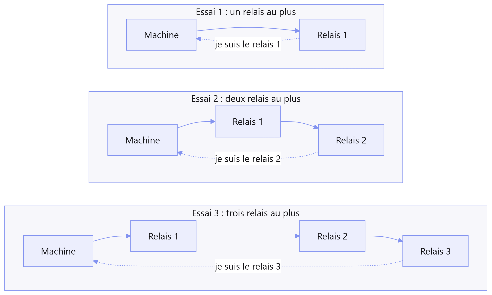

---

## Lancer la commande

| Windows | Linux | macOS |
|---|---|---|
| `tracert www.wikipedia.org` | `traceroute www.wikipedia.org` | `traceroute www.wikipedia.org` |

Chaque ligne correspond à un **relais**, et les trois temps à trois essais.

---

## Une trace

```text
  1     1 ms     1 ms     1 ms  192.168.1.1
  2     3 ms     3 ms     4 ms  203.0.113.1
  3     5 ms     4 ms     5 ms  core1.par.operateur.example
  4     *        *        *     Délai d'attente de la demande dépassé.
  5     6 ms     5 ms     6 ms  edge1.par.transit.example
  6    81 ms    80 ms    81 ms  core2.nyc.transit.example
  7    83 ms    82 ms    83 ms  gw.hebergeur.example
  8    84 ms    83 ms    84 ms  www.example.com
```

---

## Lire la trace

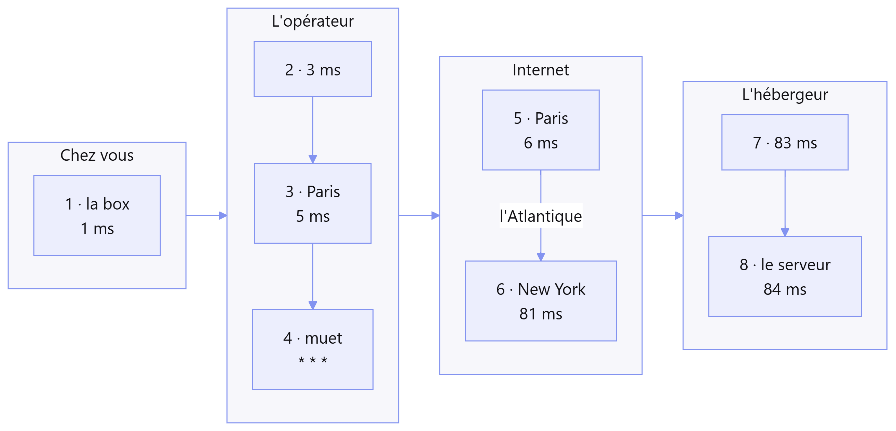

---

## Ce qu'il faut regarder

- **Les adresses** : la première est privée, c'est la box
- **Les noms** : souvent un code de ville (`par`, `nyc`, `fra`)
- **Les temps** : une forte hausse indique une longue distance

> `* * *` : le relais ne répond pas. Si les suivants répondent, le chemin
> fonctionne.

---

## Manipulations

1. Vers votre **box** : combien de relais ?
2. Vers `www.wikipedia.org` : où sont la box et l'opérateur ?
3. Vers un site sur **un autre continent** : à quel relais le temps
   augmente-t-il fortement ?

Si un site lointain répond vite, une **copie** est probablement servie près de
chez vous.

---

# Conclusion

---

## Vue d'ensemble

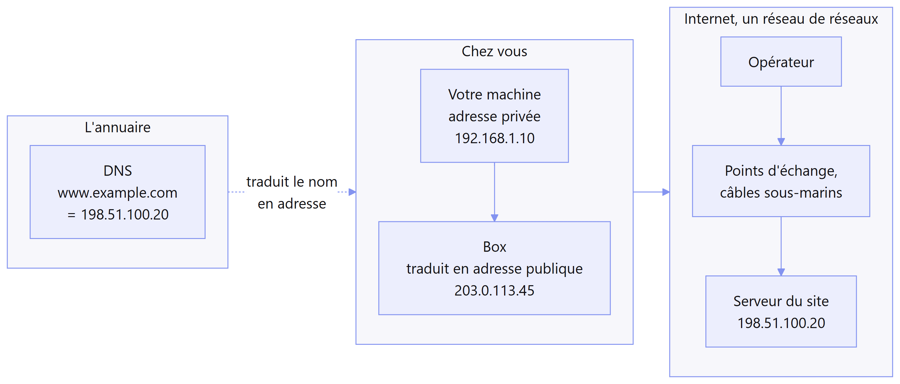

---

## Ce qu'il faut retenir

- **Le réseau** : des machines reliées ; le routeur est la porte de sortie
- **Internet** : des réseaux reliés entre eux, et par des câbles sous-marins
  entre les continents
- **L'adresse IP** : la machine, le réseau local, Internet ; la box traduit
- **IPv6** : beaucoup plus d'adresses, sans traduction
- **Le nom de domaine** : le DNS traduit les noms en adresses ; le domaine
  local reste interne à l'entreprise
- **En pratique** : afficher ses adresses et lancer `traceroute`

---

# Des questions ?

### Le support de cours reprend chaque notion, avec des exercices corrigés

Pour toute question [adressez-vous au service pédagogie](mailto:pedagogie@diginamic.fr)
